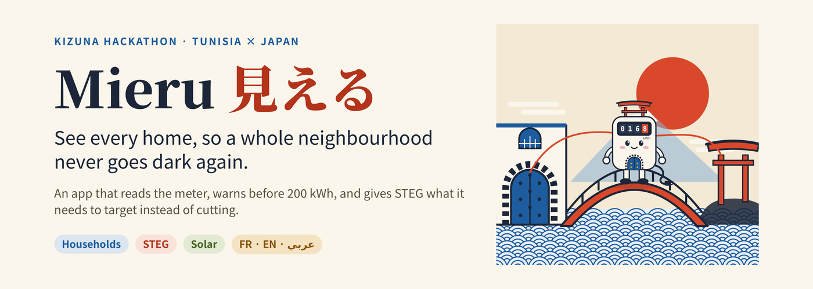
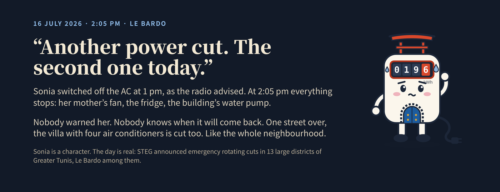
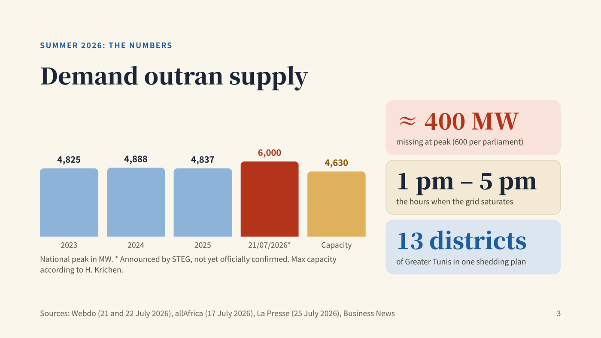
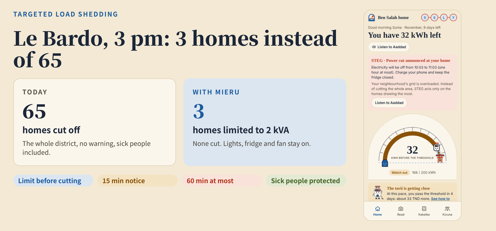
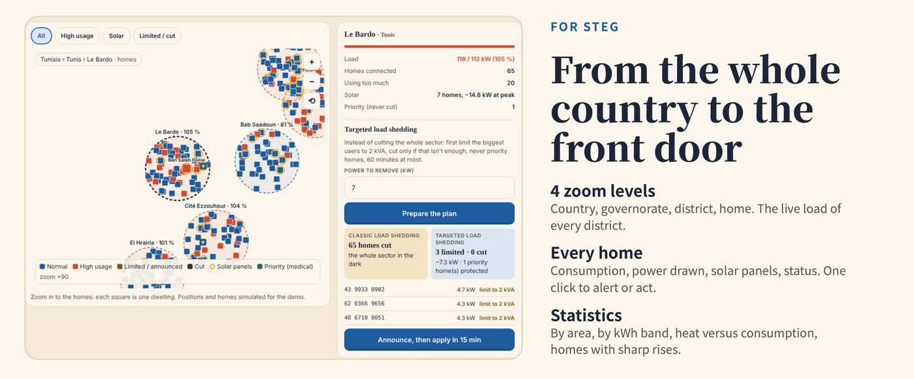
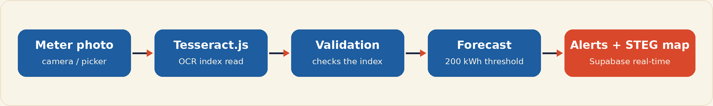
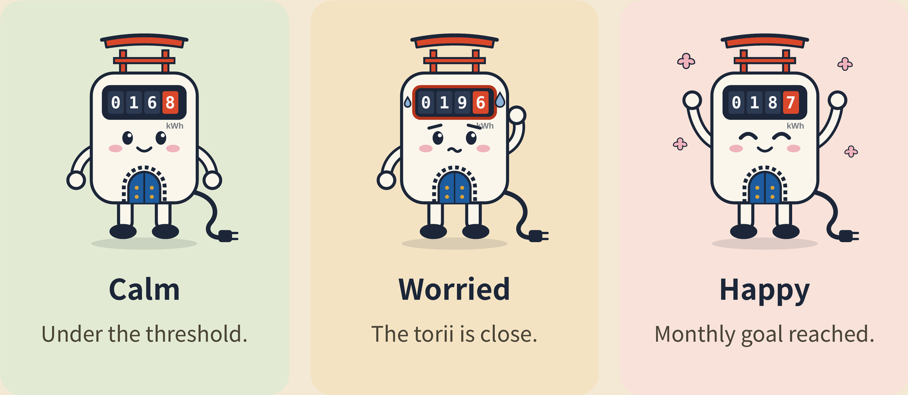
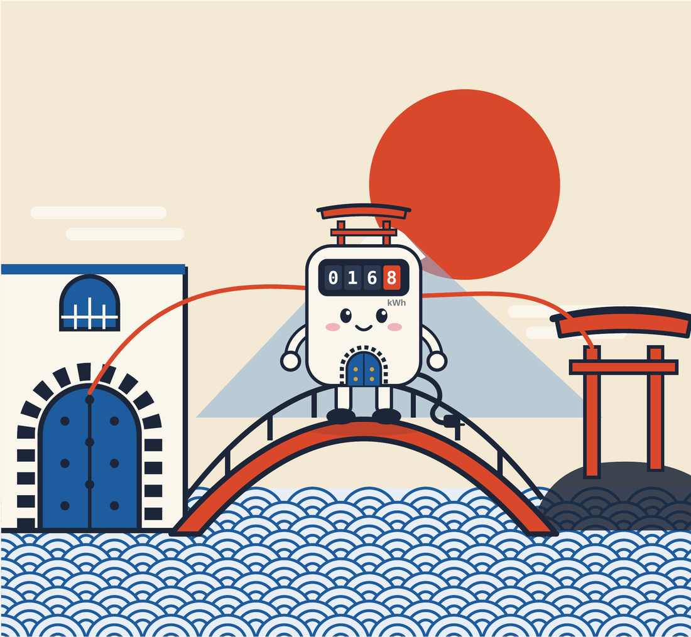
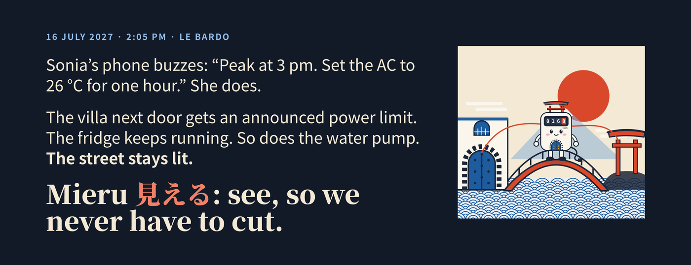

<div align="center">



<br>


**See every home, so we never have to cut a whole neighbourhood.**

[Story](#the-story) · [Problem](#problem) · [Solution](#solution) · [Features](#features) · [How it works](#how-it-works) · [Aaddad](#meet-aaddad-the-mascot) · [Installation](#installation) · [Supabase](#data-modes-and-supabase) · [Aaddad AI](#aaddad-ai-assistant) · [Team](#team)

### 👉 [Try the app](https://hackaton-kizuna.vercel.app) · [STEG dashboard (demo)](https://hackaton-kizuna.vercel.app/#/steg)

</div>

---

## Overview

Mieru is a progressive web app (PWA) built in 24 hours at the **Kizuna hackathon 🇹🇳 × 🇯🇵**. A household photographs its electricity meter, OCR reads the index, and the app warns the family before the **200 kWh** threshold. The same readings feed a home-by-home map for **STEG**, the national utility, so it can target the biggest users instead of cutting whole districts.

**Problem.** STEG sees districts, not homes. During a heatwave it cuts everyone, including households that save energy and people who depend on medical equipment.

**Solution.** Three verbs: **See** (the household reads its meter), **Connect** (readings reach STEG), **Protect** (limit the biggest users first, never touch priority homes).

> In our simulation of the Le Bardo district at 105% of capacity: **3 homes limited to 2 kVA instead of 65 homes cut off.**

## The story

<div align="center">



</div>

16 July 2026, 2:05 pm, Le Bardo. Sonia switched off the AC at 1 pm, as the radio advised. At 2:05 pm everything stops: her mother's fan, the fridge, the building's water pump. Nobody warned her. One street over, the villa with four air conditioners is cut too, like the whole neighbourhood.

*Sonia is a character. The day is real: STEG announced emergency rotating cuts in 13 large districts of Greater Tunis, Le Bardo among them (STEG statement of 16 July 2026, allAfrica).*

## Problem

Summer 2026: during the heatwave, STEG carried out rotating power cuts, district by district, across Greater Tunis.

<div align="center">



</div>

| Figure | Source |
|---|---|
| Peak demand announced at **over 6,000 MW** on 21 July 2026 (previous record: 4,888 MW in 2024) | Webdo |
| Production capacity of about **4,630 MW**, i.e. **≈ 400 MW missing** | allAfrica |
| **2.7 million** air conditioners; AC accounts for 18% of household consumption | ANME / STEG |
| Production cost **456 millimes/kWh**, average selling price **291 millimes** | Tuniscope |
| **85%** of customers use less than 200 kWh a month | Webdo |

**The insight: STEG sees districts, not homes. So it cuts districts.** Yet 85% of customers use less than 200 kWh a month. They are plunged into darkness because of a handful of homes nobody can see.

Households face a second trap: above **200 kWh a month, all of their consumption moves to the higher rate** (about +28 TND on the bill).

## Solution

<div align="center">

| 見る **See** | 繋ぐ **Connect** | 守る **Protect** |
|:---:|:---:|:---:|
| Photo of the meter, how much is left before 200 kWh, what the heat will cost | Readings flow to STEG: a map of every district and every home | Limit the biggest users first, warn 15 minutes ahead, never touch medical homes |

</div>

<div align="center">



</div>

## Features

### For households

| Feature | Description |
|---|---|
| Create, join, demo | Create a meter, join the family's meter, or try the “Ben Salah home” demo |
| Photo reading | Photo of the meter, index read by OCR, validation |
| “Kizuna bridge” gauge | Aaddad walks from the Sidi Bou Said door toward the 200 kWh torii |
| Forecast and extra cost | Estimated day the threshold is crossed, extra cost in dinars |
| Monthly chart | Readings, forecast, threshold |
| Heatwave alert | 3-day forecast (35 °C and above) and the extra kWh the AC will use |
| STEG notices | High-usage alert, announced power limit or cut, power restored |
| My solar | Production, real consumption and savings for the household and for STEG |
| Appliance simulator | What each appliance costs |
| Kakeibo | The Japanese monthly review: pick one improvement |
| Kizuna | A meter shared by the family in real time, with messages and WhatsApp invites |
| PDF complaint | Dated, sealed photos (EXIF, SHA-256, server time) |
| Accessibility | French, English, Arabic (right-to-left), read aloud by Aaddad, large text, reminder after 7 days without a reading |

### For STEG (`#/steg`)

<div align="center">



</div>

| Feature | Description |
|---|---|
| Zoomable map | Tunisia → governorates → districts → homes, with the load of each district |
| Targeted load shedding | Limits before cutting, protects priority homes, compares with cutting the whole district |
| Actions on a home | Alert, limit to 2 kVA, cut (with confirmation), restore |
| Solar | Gain per equipped home, for the household and for STEG |
| Statistics | By governorate, by kWh band, heat versus consumption, homes with sharp rises |
| Scenario | “Heatwave peak 3 pm” button to simulate summer |

**Solar gain (net billing)**
- Household gain = bill without panels − bill with panels.
- STEG gain = production × 0.472 TND/kWh (average cost) − household gain.

## How it works

<div align="center">



</div>

1. The household photographs the meter (`Releve.jsx`).
2. **Tesseract.js** reads the index and the reading is validated (`ocr.js`, `calcul.js`).
3. The forecast and extra cost are computed against the 200 kWh threshold.
4. **Open-Meteo** and **PVGIS** add the heatwave alert and the solar estimate.
5. With Supabase enabled, readings reach the STEG dashboard, which plans targeted load shedding.

### Technologies

| Technology | Purpose |
|---|---|
| React + Vite | Front end, PWA (manifest, service worker) |
| Supabase | Real-time Kizuna, photo storage, STEG tables, Edge Function |
| Tesseract.js | OCR of the meter index |
| Open-Meteo | 3-day weather forecast |
| PVGIS | Solar production estimate |
| OpenAI (server-side) | Aaddad assistant |
| node:test | 37 unit tests |

### Load shedding rules

- A household that declares medical equipment is **never** limited or cut.
- Always announced **15 minutes ahead**, **60 minutes at most**.
- Limited to **2 kVA** before any cut.

## The Japanese touch

| | Concept | In Mieru |
|---|---|---|
| 見える化 | *Mieruka*, “making it visible” | The name and the principle of the app |
| 節電 | *Setsuden*, Japan's 2011 power-saving effort | Targeted load shedding, the neighbourhood “Setsuden challenge” |
| 家計簿 | *Kakeibo*, the family budget book | The monthly review |
| 絆 | *Kizuna*, the bond | The shared family meter, the Tunisia–Japan bridge |
| 判子 | *Hanko*, the seal | The sealed photos in the complaint |

## Meet Aaddad, the mascot

<div align="center">



</div>

**Aaddad (عدّاد, “meter” in Arabic)** is the meter turned hero: a meter wearing a **torii hat** (the 200 kWh threshold), with a **Sidi Bou Said door** for a belly and **sakura cheeks**. He reacts to your consumption and reads the app aloud.

| Mood | When |
|---|---|
| Calm | Under the threshold |
| Worried | The torii is close |
| Happy | Monthly goal reached |

**Design system:** Sidi Bou Said and Hokusai blue, torii and flag vermilion, brass, olive, sakura and washi paper. Ukiyo-e print style, Japanese mincho headings, Kufic Arabic, and a gauge that is a bridge.

<div align="center">



</div>

## The vision

<div align="center">



</div>

16 July 2027, 2:05 pm. Sonia's phone buzzes: “Peak at 3 pm. Set the AC to 26 °C for one hour.” She does. The villa next door gets an announced power limit. The fridge keeps running. So does the water pump. **The street stays lit.**

## Installation

**Prerequisites:** Node.js 18 or later.

```bash
git clone https://github.com/iness33/hackaton_Kizuna.git
cd hackaton_Kizuna
npm install
npm run dev
```

Open the address shown (for example `http://localhost:5173`).

- **On a phone:** same Wi-Fi as the computer, then use the “Network” address shown by Vite.
- **Camera:** needs HTTPS or `localhost`. Forward port 5173 from the **PORTS** tab in VS Code with *Public* visibility for quick HTTPS.
- **Demo:** “Try the Ben Salah home demo” creates a 3-member meter with one month of readings (168 kWh) and 3 kWp of solar panels.
- **STEG dashboard:** “STEG space (demo)” on the welcome screen, or `#/steg`.

## Data modes and Supabase

| Mode | Condition | How it works |
|---|---|---|
| **Local** | Default, no setup | Everything on one device (localStorage and IndexedDB) |
| **Cloud** | `.env.local` filled in | Real-time Kizuna across phones, photos on Supabase, data sent to STEG |

<details>
<summary><b>Enable Supabase (about 10 minutes)</b></summary>

1. Create a free project on [supabase.com](https://supabase.com).
2. In **SQL Editor**, run `supabase/schema.sql`.
3. In **Project Settings → API**, copy the project URL and the `anon public` key.
4. Copy `.env.example` to `.env.local` and fill in:
   ```
   VITE_SUPABASE_URL=...
   VITE_SUPABASE_ANON_KEY=...
   ```
5. Restart `npm run dev`. Accounts created in local mode are not transferred.

> ⚠️ For the hackathon, access rules are deliberately simplified: anyone who knows a meter's ID can read and write to it.

</details>

## Aaddad AI assistant

The assistant goes through a **Supabase Edge Function** that calls OpenAI server-side. Meter readings are not sent to OpenAI and conversations are not stored. Limit: 20 messages per day per network address.

<details>
<summary><b>Deploy the assistant</b></summary>

1. Run `supabase/assistant.sql` in the SQL Editor.
2. Install the Supabase CLI, then:
   ```bash
   supabase link --project-ref <project-ref>
   supabase secrets set "OPENAI_API_KEY=your-key"
   supabase functions deploy aaddad-assistant
   ```
3. Fill in `.env.local`, then restart the app.

> 🔒 The OpenAI key must **never** go in `.env.local`, in a `VITE_*` variable or in client code.

</details>

## Deployment

Live on Vercel: **https://hackaton-kizuna.vercel.app**. Every `git push` to `main` redeploys automatically.

```bash
npm run build
```

To deploy from scratch: on [vercel.com](https://vercel.com), **Add New → Project**, import the repository (Vite is detected automatically). For cloud mode, add `VITE_SUPABASE_URL` and `VITE_SUPABASE_ANON_KEY` under **Settings → Environment Variables**.

## Tests

```bash
npm test
```

37 tests with Node.js `node:test`: calculations, weather, solar, STEG aggregation and privacy rules, grid and load shedding (limit before cutting, priority homes never touched, every action announced ahead, solar gains).

## Project structure

```
hackaton_Kizuna/
├── public/assets/        # Logo, Aaddad (3 moods), Kizuna bridge, patterns
├── src/
│   ├── pages/            # Bienvenue, Accueil, Releve, Simulateur, Kakeibo, Kizuna, Reclamation, Steg
│   ├── components/       # PontGauge, Graphique, Canicule, Photovoltaique, AvisSteg, CarteSteg, StegCharts...
│   ├── lib/              # calcul, reseau, steg, pv, meteo, ocr, preuve, pdf, voix, db, store
│   │   └── tarifs.json   # Tariff grid and appliance power ratings
│   ├── i18n/             # fr.js, en.js, ar.js
│   └── styles/           # tokens.css, app.css
├── supabase/             # schema.sql, assistant.sql, aaddad-assistant Edge Function
├── .env.example
└── vite.config.js        # PWA
```

File and folder names are in French, the team's working language.

## Privacy and legal framework

- **Sharing with STEG:** a condition of use, accepted once per meter. Households can always see what STEG sees (Kizuna → “What STEG sees”).
- **Never sent:** members' first names, photos, Kizuna messages, kakeibo.
- **Intended legal basis:** an agreement between the household and STEG (Tunisian Organic Law No. 2004-63, art. 29), with prior declaration to INPDP before any real roll-out.
- **Demo data:** the 1,226 homes on the map, their positions and loads are **simulated**.

## Known limits

- Check the tariff grid (`src/lib/tarifs.json`) against a real STEG bill.
- Test OCR on real meter photos and adjust the frame.
- The cloud part of the STEG dashboard has not yet been tested against a real Supabase project.
- Remote limiting or cutting requires smart meters. Without them, Mieru alerts and STEG acts on the ground.

## Roadmap

- [ ] Push notifications
- [ ] Kizuna invite QR code
- [ ] One-district pilot with STEG
- [ ] Remove obsolete `src/lib/i18n.js` and `src/components/Courbe.jsx`

## Team

| Role | Member | Scope |
|---|---|---|
| Front end | Yesmine Dhouib | `src/pages/*`, `src/components/*`, `src/styles/*` |
| Back end, calculations, Kizuna | ines.sefi | `src/lib/calcul.js`, `src/lib/db.js`, `src/lib/store.jsx`, `supabase/` |
| OCR, evidence, PDF, pitch | Tasnim Elmehrabi ([GitHub](https://github.com/tass027)) | `src/lib/ocr.js`, `src/lib/preuve.js`, `src/lib/pdf.js` |

---

<div align="center">

**Mieru 見える: see, so we never have to cut.**

ありがとう · شكرا · Thank you

</div>
